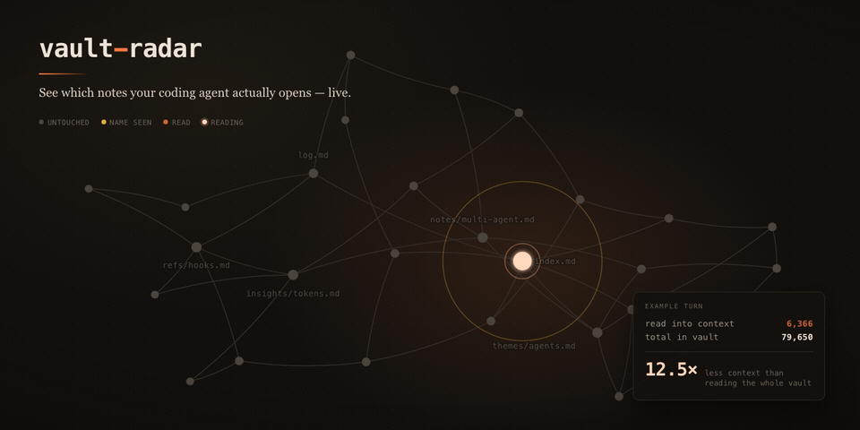

# token-watch

**Kodlama ajanının (Claude Code) not kasandaki hangi dosyaları gerçekten okuduğunu canlı izle — tek
bir `docker compose up` ile.**


Claude Code'a bir soru soruyorsun, cevap veriyor. Peki 90 notunun hangilerini açtı, hangilerini
yalnızca bir aramada adıyla gördü, hangilerine hiç dokunmadı? `token-watch` bunu olurken ekranda
gösterir ve o turda okunan token'ı kasanın toplamıyla karşılaştırır.



```
❯ Pentaho ile alakalı bildiklerimizi anlatır mısın

  ▪ index.md                                   ← okundu
  ▪ entities/pentaho-server.md                 ← okundu
  ▪ architecture/sap-pentaho-postgresql-...    ← okundu
  ░ log.md                                     ← grep gördü, açılmadı
  · 80 dosya daha                              ← hiç dokunulmadı

  ~9.800 okunan  /  ~82.000 toplam  =  8,4× tasarruf
```

> `token-watch`, Selma Kocabıyık'ın açık kaynak **[vault-radar](https://github.com/selmakcby/vault-radar)**
> projesinin bir çatalıdır (fork). Temel tasarım ve kodun büyük kısmı ona aittir. Bu depo; aracı
> **Docker** ile her ortamda çalışır hale getiren paketlemeyi, **Windows + PowerShell** ve Türkçe
> içerik düzeltmelerini ve görüntüleyici iyileştirmelerini içerir. Orijinal İngilizce belge:
> [README.vault-radar.md](README.vault-radar.md).

---

## İçindekiler

- [Hızlı başlangıç](#hızlı-başlangıç)
- [Mimari: ne konteynerde, ne ana makinede?](#mimari-ne-konteynerde-ne-ana-makinede)
- [Kurulum](#kurulum)
  - [1. Sunucuyu Docker ile başlat](#1-sunucuyu-docker-ile-başlat)
  - [2. Hook'u Claude Code'a bağla](#2-hooku-claude-codea-bağla)
  - [3. (İsteğe bağlı) Obsidian eklentisi](#3-isteğe-bağlı-obsidian-eklentisi)
- [Docker referansı](#docker-referansı)
- [Kullanım](#kullanım)
- [Renkler ve durumlar](#renkler-ve-durumlar)
- [Kasanın boyutunu ölçmek](#kasanın-boyutunu-ölçmek)
- [Gizlilik ve güvenlik](#gizlilik-ve-güvenlik)
- [Sorun giderme](#sorun-giderme)
- [Docker'sız çalıştırma (Python)](#dockersız-çalıştırma-python)
- [Upstream'den farklar](#upstreamden-farklar)
- [Sınırlamalar](#sınırlamalar)
- [Proje yapısı](#proje-yapısı)
- [Geliştirme ve test](#geliştirme-ve-test)
- [Lisans ve atıf](#lisans-ve-atıf)

---

## Hızlı başlangıç

**Gerekenler:** Docker (Docker Desktop ya da Docker Engine + Compose v2), Claude Code ve ana
makinede Python 3.9+ (hook için; [Python'suz seçenek](#pythonu-olmayan-makinede-hook) de var).

```bash
# 1) Kodu al
git clone https://github.com/ksglmehmet/token-watch.git
cd token-watch

# 2) Ayar dosyasını oluştur ve VAULT_PATH'i not klasörüne ayarla
cp env.example .env                 # Windows PowerShell: Copy-Item env.example .env
#   VAULT_PATH=/home/sen/notlar     # Windows: VAULT_PATH=C:/Users/sen/Belgeler/Kasa

# 3) Sunucuyu başlat
docker compose up -d --build
```

```bash
# 4) Hook'u Claude Code'a bağla: çıktıyı .claude/settings.json'a ekle (ayrıntı: Kurulum → 2)
python radar.py install
```

**5)** Tarayıcıda **<http://localhost:7777>** adresini aç (tam ekran için
<http://localhost:7777/?wide=1>) ve Claude Code'a kasanla ilgili bir soru sor.

> Önce arayüzü görmek istersen hook kurmadan <http://localhost:7777/?demo=1> adresini aç.

---

## Mimari: ne konteynerde, ne ana makinede?

```
 ┌─────────────────────────── ana makine ───────────────────────────┐
 │                                                                   │
 │  Claude Code ──(hook, her araç çağrısında)──► radar.py hook        │
 │                                                    │              │
 │                                                    ▼              │
 │                                     ~/.vault-radar/events.jsonl   │
 │                                         │                 │       │
 │   ┌──────── Docker konteyneri ────────┐ │                 │       │
 │   │ radar.py serve  ◄── /data (bind) ─┼─┘                 │       │
 │   │       ▲          ◄── /vault (ro) ─┼── not klasörün    │       │
 │   │       │ SSE                       │                   ▼       │
 │   └───────┼───────────────────────────┘     Obsidian eklentisi    │
 │           │ 127.0.0.1:7777                  (dosyayı doğrudan okur)│
 │     tarayıcı görüntüleyicisi                                       │
 └───────────────────────────────────────────────────────────────────┘
```

| Parça | Nerede çalışır | Neden |
|---|---|---|
| **Sunucu + görüntüleyici** (`radar.py serve`) | **Docker konteyneri** | Uzun süre açık kalan bağımsız bir servis; her ortamda aynı imajla kalkar |
| **Hook** (`radar.py hook`) | Ana makine (önerilen) | Claude Code onu her araç çağrısında ana makinede başlatır; hızlı olmalıdır (~1 sn) |
| **Obsidian eklentisi** | Ana makine | Obsidian'ın içinde çalışır; sunucuya ihtiyaç duymaz |

Hook ile konteyner ana makinedeki tek bir dosya üzerinden konuşur:
**hook `~/.vault-radar/events.jsonl` dosyasına yazar, konteyner onu bind mount ile okur.**

1. **Hook.** Claude Code her araç çağrısından sonra `PostToolUse` olayını tetikler.
   `radar.py hook` olay verisini stdin'den JSON olarak okur ve olay dosyasına tek satır ekler.
   `Read`, `Grep`, `Glob`, `Bash` ve `PowerShell` araçlarını yakalar (`cat`, `head`,
   `Get-Content`, `Select-String` gibi kabuk okumaları dahil). Ayrıca `UserPromptSubmit`
   (yeni soru) ve `Stop` (tur bitti) olaylarını kaydeder. Hook **asla** turu bloklamaz: bozuk
   veri sessizce yutulur, çıkış kodu her zaman 0'dır.
2. **Sunucu.** Konteyner açılışta kasayı tarar (yol, boyut, token tahmini, `[[wikilink]]`
   bağları), olay dosyasını izler ve her yeni satırı Server-Sent Events ile tarayıcıya iter.
3. **Görüntüleyici.** Tek bir HTML sayfası. Kasadaki her not bir düğümdür; ajan dokundukça düğüm
   yanar ve küçük bir imleç sorudan okunan dosyaya doğru yürür.

---

## Kurulum

### 1. Sunucuyu Docker ile başlat

İmaj `python:3.12-slim` tabanlıdır. Bu taban birden çok mimari için yayınlandığından imaj
**Intel/AMD PC'lerde, Apple Silicon Mac'lerde ve ARM sunucularda** aynı komutla derlenir. Ek
Python paketi yoktur; imaj ~120 MB'tır. Windows 11 + Docker Desktop (WSL 2) üzerinde test edildi.

```bash
cp env.example .env                  # Windows PowerShell: Copy-Item env.example .env
```

`.env` dosyasını düzenle:

| Değişken | Varsayılan | Anlamı |
|---|---|---|
| `VAULT_PATH` | **zorunlu** | Not klasörün. Konteynere **salt okunur** bağlanır (`/vault`). Windows'ta ileri eğik çizgi: `C:/Users/sen/Kasa` |
| `RADAR_DATA` | `~/.vault-radar` | Hook'un olay dosyasının klasörü (`/data`). Hook ile **aynı** klasör olmalı. SIFIRLA düğmesi için yazılabilir bağlanır |
| `RADAR_PORT` | `7777` | Ana makinedeki port; yalnızca `127.0.0.1`'de açılır |
| `VAULT_RADAR_CPT` | `3.8` | Token tahmini için token başına karakter (İngilizce ≈4,0, Türkçe ≈3,6) |
| `RADAR_UID` / `RADAR_GID` | `1000` | Yalnızca Linux: kendi `id -u` / `id -g` değerin (dosya sahipliği için) |

Başlat ve kontrol et:

```bash
docker compose up -d --build
docker compose ps          # STATUS sütununda (healthy) görünmeli
docker compose logs        # ilk satır: token-watch  | vault-radar · N files · ~X tokens
```

Konteyner `restart: unless-stopped` ile tanımlıdır; Docker açıldığında kendiliğinden kalkar.

> **Windows:** Docker Desktop açılışta kendiliğinden başlamayabilir. Kapalıyken
> `failed to connect to the docker API … dockerDesktopLinuxEngine` hatası alırsın; önce Docker
> Desktop'ı aç.

### 2. Hook'u Claude Code'a bağla

Hook ana makinede çalışır ve Python 3.9+ ister (yalnızca standart kütüphane). Hazır bloğu yazdır:

```bash
python radar.py install        # Windows
python3 radar.py install       # macOS / Linux
```

Çıktıyı bir Claude Code ayar dosyasına, var olan `"hooks"` bloğuyla **birleştirerek** ekle:

| Dosya | Kapsam |
|---|---|
| `~/.claude/settings.json` | Tüm Claude Code oturumların |
| `<proje>/.claude/settings.json` | Yalnızca o klasörden başlatılan oturumlar (**önerilen**: log daha az şey toplar) |

Windows için örnek blok (yolu kendi klon yerinle değiştir; ileri eğik çizgi kullan):

```json
{
  "hooks": {
    "PostToolUse": [
      {
        "matcher": "Read|Grep|Glob|NotebookRead|Bash|PowerShell",
        "hooks": [{ "type": "command", "command": "python C:/yol/token-watch/radar.py hook" }]
      }
    ],
    "UserPromptSubmit": [
      { "hooks": [{ "type": "command", "command": "python C:/yol/token-watch/radar.py hook" }] }
    ],
    "Stop": [
      { "hooks": [{ "type": "command", "command": "python C:/yol/token-watch/radar.py hook" }] }
    ]
  }
}
```

> **Dikkat — geçersiz JSON:** Bloğu bir web sayfasından ya da sohbetten kopyalarken `python` ile
> yolun arasına görünmez bir **TAB** karakteri girebilir. JSON buna izin vermez ve Claude Code
> dosyanın tamamını okuyamaz; aynı dosyadaki `permissions`/`deny` kuralların da devre dışı
> kalabilir. Ekledikten sonra doğrula:
>
> ```powershell
> python -c "import json;json.load(open('.claude/settings.json',encoding='utf-8'));print('OK')"
> ```

> **Not — auto mode:** Claude Code'un auto mode'u, ajanın kendi ayar dosyasına hook yazmasını
> "kendi ayarını değiştirme" olarak engeller. Bu bloğu ayar dosyasına **sen** eklemelisin.

Hook, ayar kaydedildikten sonra çoğu zaman açık oturumda da hemen çalışır; emin olmak için Claude
Code'u yeniden başlat. Çalıştığını şöyle görürsün:

```powershell
Get-Content ~/.vault-radar/events.jsonl -Tail 3      # Windows
tail -3 ~/.vault-radar/events.jsonl                   # macOS / Linux
```

#### Python'u olmayan makinede hook

Hook da aynı Docker imajıyla çalıştırılabilir. İmajı önceden derle (`docker compose build`) ve ayar
dosyasındaki her `command` değerini şöyle yap:

```json
"command": "docker run --rm -i -v $HOME/.vault-radar:/data token-watch hook"
```

Windows'ta Claude Code hook'ları Git Bash ile çalıştırır; Git Bash `C:/...:/data` biçimindeki yolu
bozmasın diye başına `MSYS_NO_PATHCONV=1` ekle:

```json
"command": "MSYS_NO_PATHCONV=1 docker run --rm -i -v C:/Users/sen/.vault-radar:/data token-watch hook"
```

> Bu yöntem çalışır ama **her araç çağrısına ~3 sn** ekler (her çağrıda yeni konteyner başlar;
> ana makinedeki Python ile ~1 sn). Python kurulabiliyorsa ana makinede çalıştırmak çok daha hızlıdır.

### 3. (İsteğe bağlı) Obsidian eklentisi

Eklenti, Obsidian'ın **kendi grafik görünümünü** boyar ve olay dosyasını doğrudan okur. Konteynere
ihtiyaç duymaz; hook yeterlidir.

**macOS / Linux:**

```bash
./install-obsidian-plugin.sh ~/yol/kasan
```

**Windows (PowerShell)** — betik `python3` beklediği için elle kurmak daha kolay:

```powershell
$vault = "C:\yol\kasan"
New-Item -ItemType Directory -Force "$vault\.obsidian\plugins\vault-radar" | Out-Null
Copy-Item obsidian-plugin\manifest.json, obsidian-plugin\main.js "$vault\.obsidian\plugins\vault-radar\"
# community-plugins.json yoksa oluştur; varsa listeye "vault-radar" ekle
if (-not (Test-Path "$vault\.obsidian\community-plugins.json")) {
  '["vault-radar"]' | Set-Content -Encoding utf8 "$vault\.obsidian\community-plugins.json"
}
```

Ardından Obsidian'da:

1. **Ayarlar → Topluluk eklentileri → Kısıtlı modu kapat.**
2. Kasayı yeniden yükle ve **Vault Radar**'ın açık olduğunu kontrol et.
3. Grafik görünümünü aç (sol şeritteki grafik simgesi ya da `Ctrl+G`) ve ajana bir soru sor.

Çalışıyorsa sağ alttaki durum çubuğunda `radar: …` yazısı ve grafikte küçük bir robot görünür.
Robot, ajan bir dosyayı açtığında grafiğin **gerçek bağlantıları** üzerinden o nota yürür. İki not
bağlı değilse doğrudan atlar; bu da o sayfanın, ajanın bulunduğu yerden link ile ulaşılamadığını
gösterir. Komutlar: **Clear radar highlighting**, **Reconnect to event log**,
**Write graph diagnostics to disk**.

> ⚠️ Eklenti Obsidian'ın herkese açık olmayan iç API'sine dayanır (`renderer.nodeLookup`,
> `node.color`, `renderer.changed()`; 1.13.7'de doğrulandı). Bir sürüm bunları değiştirirse eklenti
> yalnızca boyamayı bırakır ve `~/.vault-radar/obsidian-debug.json` dosyasına teşhis yazar.
> Kasan git ile sürümleniyorsa `.obsidian/plugins/` klasörünü `.gitignore`'a eklemeyi düşün.

---

## Docker referansı

### Günlük komutlar

```bash
docker compose ps                # durum ve sağlık kontrolü
docker compose logs -f           # sunucu çıktısı
docker compose restart           # kasaya yeni not eklendiyse yeniden tara
docker compose down              # durdur ve kaldır
git pull && docker compose up -d --build    # yeni sürüme güncelle
```

### Compose olmadan

```bash
docker build -t token-watch .
docker run -d --name token-watch --restart unless-stopped \
  -p 127.0.0.1:7777:7777 \
  -v "/yol/kasan:/vault:ro" \
  -v "$HOME/.vault-radar:/data" \
  -e VAULT_RADAR_CPT=3.6 \
  token-watch
```

Windows PowerShell'de satır devamı için `\` yerine `` ` `` kullan ve yolları `C:/Users/sen/...`
biçiminde yaz.

### Başka mimari için imaj

```bash
docker buildx build --platform linux/amd64,linux/arm64 -t <kayıt>/token-watch:latest --push .
```

### İmajın içeriği

| Öğe | Değer |
|---|---|
| Taban | `python:3.12-slim` (amd64, arm64, …) |
| İçerik | Yalnızca `radar.py` ve `ui/` (`.dockerignore` gerisini dışarıda bırakır) |
| Kullanıcı | `radar` (uid/gid 1000), root değil |
| Port | `7777` |
| Bağlama noktaları | `/vault` (not klasörü, salt okunur), `/data` (olay dosyası) |
| Sağlık kontrolü | 30 sn'de bir `GET /api/vault` |
| Ortam | `VAULT_RADAR_HOME=/data`, `VAULT_RADAR_BIND=0.0.0.0`, `VAULT_RADAR_CPT=3.8` |
| Varsayılan komut | `serve --vault /vault --no-open --port 7777` (giriş noktası `python /app/radar.py`) |

### Güvenlik ayarları

`docker-compose.yml` konteyneri sıkılaştırılmış biçimde başlatır:

- Port yalnızca **`127.0.0.1`**'de yayınlanır; ağdaki başka makineler erişemez. Konteyner içinde
  `0.0.0.0` dinlenir, ama sunucu yine yalnızca loopback `Host` başlığı taşıyan istekleri kabul eder
  (başka bir `Host` → 403).
- Not klasörü **salt okunur** bağlanır; konteyner notlarını değiştiremez.
- Salt okunur kök dosya sistemi (`read_only`), tüm Linux yetenekleri düşürülmüş (`cap_drop: ALL`),
  `no-new-privileges`.
- `.env`, `CLAUDE.md` ve sırlar derleme bağlamına alınmaz.

---

## Kullanım

1. Görüntüleyiciyi (<http://localhost:7777>) ya da Obsidian grafiğini aç.
2. Claude Code'a kasanla ilgili bir soru sor.
3. Ajan dosyaları okudukça düğümler yanar; alt kısımda okunan token, toplam token ve tasarruf
   oranı güncellenir.
4. Her yeni soru (prompt) ekranı sıfırlar; yalnızca o turun okumaları görünür.

| Düğme | Ne yapar |
|---|---|
| **GENİŞLET** | Paneli tam ekrana açar; yazı, düğüm ve bağlar ekran boyuna göre büyür |
| **DEMO** | Kayıtlı bir izi sahte bir kasa üzerinde oynatır (hook kurmadan arayüzü denemek için) |
| **SIFIRLA** | Olay dosyasını siler ve ekranı temizler |

Yer imleri: `http://localhost:7777/?wide=1` (geniş mod), `http://localhost:7777/?demo=1` (demo).

## Renkler ve durumlar

| Görüntüleyici | Obsidian | Anlamı |
|---|---|---|
| gri, adsız | varsayılan | Bu turda dokunulmadı |
| sarı | kehribar | Bir `grep`/`glob` eşleşti; ajan dosyanın **adını** gördü, içeriğini değil |
| turuncu + ad | turuncu | Açıldı ve bağlama okundu |
| — | açık şeftali, büyük | Şu anda okunuyor |

Sarı durum ilginç olanıdır: kırk dosya adı döndüren bir arama neredeyse bedavadır, kırk dosyayı
açmak ise pahalıdır. Radar bu farkı gösterir.

## Kasanın boyutunu ölçmek

Konteyner açılışta toplam dosya ve tahmini token sayısını yazar:

```bash
docker compose logs | head -1
# token-watch  | vault-radar · 92 files · ~86,357 tokens
```

Türkçe içerik için `.env` içinde `VAULT_RADAR_CPT=3.6` yap ve `docker compose up -d` ile yeniden
başlat. Yalnızca kelime ve karakter sayısı için, kasanın kökünde (PowerShell):

```powershell
Get-ChildItem -Recurse -Filter *.md | Where-Object FullName -notmatch '\\\.obsidian\\' |
  Get-Content -Raw -Encoding UTF8 | Measure-Object -Word -Character
```

Token sayıları **dosya boyutundan tahmindir** (bayt / oran), gerçek tokenizer çıktısı değildir.
Orantı görmek içindir, faturalama için değil. Sayıma `.md` dosyaları girer; nokta ile başlayan
klasörler (`.obsidian`, `.git`) atlanır.

## Gizlilik ve güvenlik

- **Dışarıya hiçbir şey gönderilmez.** Kodda dış ağ isteği yoktur. Görüntüleyici yalnızca bu
  makineden erişilebilir; Host/Origin kontrolü DNS rebinding'e ve başka sitelerden gelen isteklere
  kapalıdır.
- **Olay dosyası hassas olabilir.** `~/.vault-radar/events.jsonl` şunları tutar: her prompt'un
  **ilk 400 karakteri**, okunan dosya yolları, arama yapan kabuk komutlarının ilk 80 karakteri,
  oturum kimliği ve çalışma klasörü (`cwd`). Yerelde kalır ama şirket ya da kişisel bilgi
  içerebilir. Paylaşma; gerekirse **SIFIRLA** düğmesiyle ya da dosyayı silerek temizle.
- **Kapsamı dar tut.** Hook'u kullanıcı geneli yerine yalnızca ilgili proje klasörünün
  `.claude/settings.json` dosyasına eklemek, log'a giren prompt sayısını azaltır.
- **Gecikme.** Her hook çağrısı yeni bir süreç başlatır: ana makinede Python ile ~1 sn, Docker ile
  ~3 sn (Windows'ta ölçüldü).

## Sorun giderme

| Belirti | Sebep | Çözüm |
|---|---|---|
| `set VAULT_PATH in .env` | `.env` yok ya da `VAULT_PATH` boş | `cp env.example .env` ve `VAULT_PATH`'i doldur |
| `failed to connect to the docker API` | Docker çalışmıyor | Docker Desktop'ı / Docker servisini başlat |
| `port is already allocated` | 7777'yi başka bir süreç kullanıyor (ör. açık kalmış `python radar.py serve`) | O süreci durdur ya da `.env` içinde `RADAR_PORT`'u değiştir |
| `events.jsonl` hiç oluşmuyor | Hook çalışmıyor | Ayar dosyasının geçerli JSON olduğunu doğrula (TAB uyarısı); Claude Code'u yeniden başlat |
| Görüntüleyici "canlı" ama hiçbir şey yanmıyor | `RADAR_DATA` hook'un yazdığı klasör değil, okunan dosyalar `VAULT_PATH` dışında ya da o turda hiç okuma yok | `docker compose logs` içinde `events : /data/events.jsonl` satırına ve ana makinedeki dosyanın büyüdüğüne bak; alt kısımdaki "vault dışı: N" sayacına bak |
| Görüntüleyici "bağlanıyor"da kalıyor | Konteyner kapalı ya da port farklı | `docker compose ps`; adresin `RADAR_PORT` ile eşleştiğini kontrol et |
| Yeni notlar görünmüyor | Kasa açılışta taranır | `docker compose restart` |
| Linux'ta `Permission denied` (`/data`) | Konteyner kullanıcısı ile dosya sahibi farklı | `.env` içinde `RADAR_UID`/`RADAR_GID` değerlerini `id -u`/`id -g` ile eşle |
| Prompt'ta `Ã`, `Å` gibi bozuk karakterler | Upstream sürüm stdin'i ANSI kod sayfasıyla okuyordu | Bu çatalın `radar.py`'sini kullan |
| PowerShell okumaları görünmüyor | Matcher'da `PowerShell` yok | Hook bloğundaki `matcher` değerini güncelle |
| Obsidian'da renk yok | Kısıtlı mod açık ya da iç API değişti | Kısıtlı modu kapat; `~/.vault-radar/obsidian-debug.json` dosyasına bak |

---

## Docker'sız çalıştırma (Python)

Docker kullanmak istemezsen sunucu doğrudan Python ile de çalışır (3.9+, ek paket yok):

```bash
python radar.py serve --vault "C:/yol/kasan" --no-open      # macOS/Linux: python3
```

Komutu `radar.py`'nin bulunduğu klasörden çalıştır ya da tam yolunu ver; terminal açık kalmalı.
`--no-open` olmadan, bulunursa Chrome/Edge'de ekranın sağına yapışık, çerçevesiz bir pencere açılır.
Docker sürümüyle aynı anda çalıştırma: ikisi de 7777 portunu kullanır.

| Bayrak / ortam değişkeni | Varsayılan | Anlamı |
|---|---|---|
| `--vault` | zorunlu | İzlenecek klasör |
| `--port` | `7777` | Görüntüleyici portu |
| `--host` / `VAULT_RADAR_BIND` | `127.0.0.1` | Dinlenecek adres (konteynerde `0.0.0.0`) |
| `--ext` | `.md` | İzlenecek uzantılar (virgülle) |
| `--no-open` | kapalı | Pencere açma |
| `--width` | `520` | Yapışık pencere genişliği (px) |
| `VAULT_RADAR_HOME` | `~/.vault-radar` | Olay dosyasının klasörü |
| `VAULT_RADAR_CPT` | `3.8` | Token başına karakter (İngilizce ≈4,0, Türkçe ≈3,6) |

## Upstream'den farklar

| Alan | vault-radar | token-watch |
|---|---|---|
| Dağıtım | Python ile elle çalıştırma | **Docker imajı + sıkılaştırılmış compose**; `--host` seçeneği |
| PowerShell aracı | İzlenmiyor | `Get-Content`/`gc`, `Select-String`, `Get-ChildItem` yakalanıyor; matcher'a `PowerShell` eklendi |
| Türkçe karakterler (Windows) | stdin ANSI kod sayfasıyla okunuyordu (`Değiştirdim` → `DeÄŸiÅŸtirdim`) | stdin her zaman UTF-8 |
| Grep çıktısı (Windows) | `C:\yol\a.md:12:eşleşme` satırında yol `C` kalıyordu | Sürücü harfi korunuyor |
| Görüntüleyici yol eşleme | Yalnızca `/`; Windows'ta hiçbir okuma eşleşmiyordu | `\` ve `/` ikisi de tanınıyor |
| Sunucu logu (Windows) | Sekme kapanınca `WinError 10053/10054` traceback'leri | Bağlantı kopmaları sessizce geçiliyor |
| Geniş mod | Yalnızca panel büyüyor; yazı 9px, bağlar neredeyse görünmez | Yazı, düğüm ve çizgiler ekranla ölçekleniyor; yerleşim ekran oranına yayılıyor; `?wide=1` |
| Pencere açma (Windows) | Yalnızca macOS/Linux tarayıcı yolları | Windows Chrome/Edge yolları eklendi |

Etiket davranışı upstream ile aynıdır: **yalnızca okunan** notların adı görünür.

## Sınırlamalar

- Okumalar dosya adına göre eşlenir; farklı köklerde aynı göreli yola sahip iki dosya karışabilir.
- `Grep` sonuçlarının ayrıştırılması en iyi çabadır: aracın yanıt biçimi herkese açık bir sözleşme
  değildir. Kabuk aramalarında (`rg`, `Select-String`) eşleşen dosyalar çıkarılmaz.
- Aynı anda tek oturum: iki Claude Code oturumu aynı log'a yazar; görüntüleyici en son prompt
  gönderen oturumu izler.
- Kabuk okuma tespiti komut metnine dayalı bir tahmindir; yalnızca ilk dosya argümanı sayılır.
- Kasa yalnızca açılışta taranır; yeni notlar için `docker compose restart`.
- Yalnızca yerel kullanım için tasarlanmıştır; ağa açmak amaçlanmamıştır.

## Proje yapısı

```
token-watch/
├── Dockerfile                  # sunucu imajı (python:3.12-slim, çok mimarili, root değil)
├── docker-compose.yml          # loopback'e bağlı, sıkılaştırılmış servis tanımı
├── env.example                 # compose ayarlarının şablonu (.env olarak kopyala)
├── .dockerignore               # imaja yalnızca radar.py ve ui/ girer
├── .gitattributes              # betik ve Docker dosyaları LF satır sonuyla kalır
├── radar.py                    # hook, SSE sunucusu, install çıktısı (tek dosya, bağımlılık yok)
├── ui/index.html               # tek dosyalık canlı görüntüleyici
├── obsidian-plugin/
│   ├── main.js                 # Obsidian grafiğini boyayan eklenti
│   └── manifest.json
├── install-obsidian-plugin.sh  # eklenti kurulum betiği (macOS / Linux)
├── assets/                     # README görselleri
├── README.vault-radar.md       # upstream'in orijinal İngilizce belgesi
├── CONTRIBUTING.md             # upstream katkı kuralları
└── LICENSE                     # MIT (upstream + bu çatalın telif bildirimleri)
```

## Geliştirme ve test

Test paketi yok; elle doğrulama:

```bash
# İmaj derleniyor mu, konteyner sağlıklı mı?
docker compose up -d --build && docker compose ps

# Hook bozuk girdide sessiz kalmalı ve 0 ile çıkmalı
echo 'not json' | python radar.py hook; echo $?
echo 'not json' | docker run --rm -i token-watch hook; echo $?

# Türkçe karakter — gerçek log'u kirletmemek için geçici klasör
export VAULT_RADAR_HOME=/tmp/radar-test          # PowerShell: $env:VAULT_RADAR_HOME = "$env:TEMP\radar-test"
echo '{"hook_event_name":"UserPromptSubmit","prompt":"Değiştirdim","session_id":"t"}' | python radar.py hook
cat /tmp/radar-test/events.jsonl                # bozulmadan görünmeli
```

Arayüzü hook olmadan denemek için `?demo=1`. `radar.py` üçüncü parti paket almaz (upstream kuralı).

Upstream güncellemelerini almak için:

```bash
git remote add upstream https://github.com/selmakcby/vault-radar.git
git fetch upstream
git merge upstream/main        # çakışmaları çöz; rebase değil merge
```

## Lisans ve atıf

MIT — bkz. [LICENSE](LICENSE).

- Orijinal eser: **vault-radar** © 2026 Selma Kocabıyık — <https://github.com/selmakcby/vault-radar>
- Docker paketlemesi, Windows/Türkçe düzeltmeleri ve görüntüleyici değişiklikleri: **token-watch**
  © 2026 Mehmet Akif KÖSOĞLU

Anthropic ile bağlantılı değildir ve Anthropic tarafından onaylanmamıştır. "Claude" ve
"Claude Code" Anthropic'in ticari markalarıdır; bu proje yalnızca Claude Code'un zaten ürettiği hook
verisini okur.
